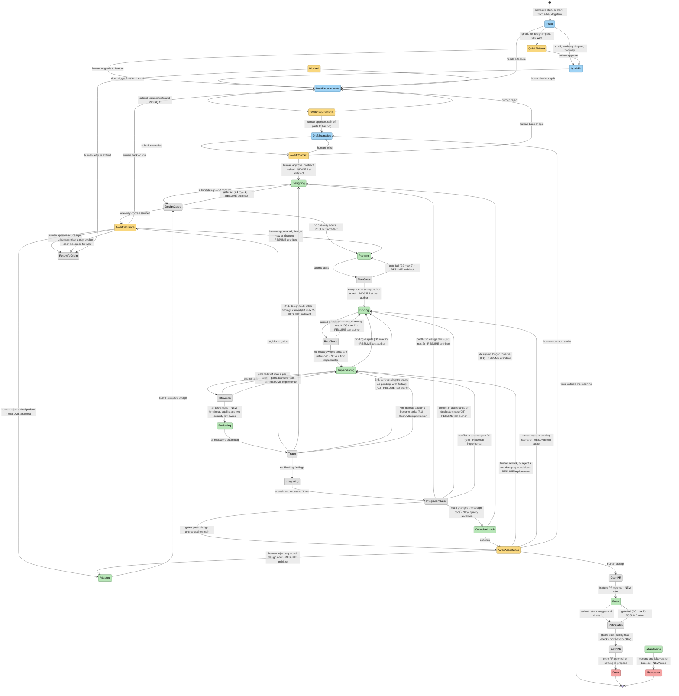
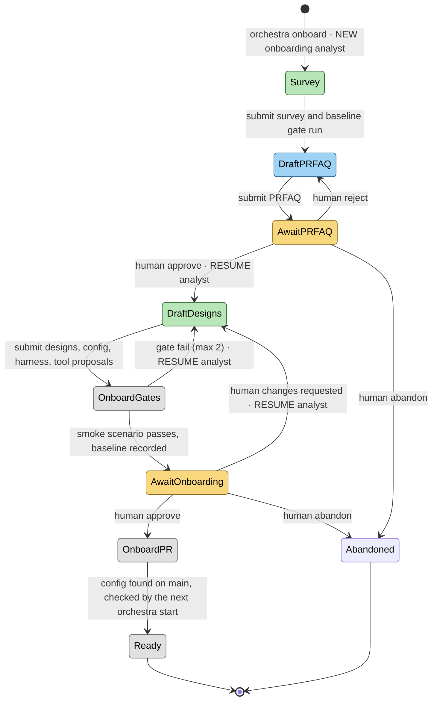

# Orchestra v0 plan

Draft 4, 2026-11-28. Draft 3 was reviewed three times before the spikes. Draft 4 folds in the results of spikes 1 to 7 and two further reviews, by Fable 5.2 and Opus 5.5 at high effort, of draft 3 against the spike evidence. Research background: [agentic dev frameworks, November 2026](../research/2026-11-agentic-dev-frameworks.md). Spike reports are in [docs/spikes](../spikes/). The changes in this draft are listed at the end.

Orchestra v0 is a Python CLI plus a small set of agents and skills that runs one feature from an idea to an open pull request. Agents do the judgment work. The CLI owns everything that must not depend on an agent remembering: each feature's state, the legal transitions, when a fresh agent takes over, the gates each step must pass, every git write, and the caps that stop agent loops. The human is out of the development loop except for four kinds of decision: the feature's high-level requirements, the behaviour contract (given/when/then scenarios), one-way-door decisions, and final acceptance. v0 builds the whole state machine with thin agent prompts. It proves the machine first with a scripted fake agent, then tests the framework in two dry runs against a pass bar set in advance: at most twice the cost of a single-session baseline, and fewer defects than it.

## 1. Principles

These come from Ali's design and from the research. Each one constrains something below.

1. **Autonomous.** Once the human has approved the contract, the system designs, plans, builds, reviews and integrates without asking. It asks only at checkpoints the flow defines.
2. **Trusted.** Trust comes from three sources, in order of strength: deterministic checks (tests, linters, static analysis, contract hashes), the human-approved behaviour contract, and independent agent review. Agent review is necessary but never sufficient, and it never overrides a deterministic check. The definitions of the gates are read from the main branch, never from the branch being gated.
3. **One-way doors go to the human.** A decision is a one-way door if it is hard to reverse or commits real money. Everything else is a two-way door: the agent decides, logs the decision, and moves on. A flow finishes on its best assumption and raises the door at its checkpoint, except for the few doors that must stop work at once (section 4.2).
4. **Fresh context only for a reason.** A step gets a new agent for one of two reasons: it must be independent of the work it judges (acceptance bindings, review, retro), or the role's session has grown past a size threshold. The flow definition decides which steps get a new agent, never the agent.
5. **Forward iteration for agents.** An agent loop either retries the step before it, under a small cap, or turns findings into tasks that flow forward. Returns to earlier flows happen only for human decisions and for design or contract faults that triage finds, under one shared cap. The human's own rejections are never capped, only warned about.
6. **Self-improving.** Every feature ends with a retrospective that improves the project (checks first, then rules, then backlog) and, when warranted, drafts improvements to Orchestra itself. Pruning is part of every retrospective. Retro's changes reach main through their own pull request, which the human reviews.
7. **Repo rules win.** A repository's own rules override Orchestra's skills. Deterministic checks the repository defines are never weakened by the framework, and an agent weakening one is a one-way door.
8. **Skills are guidelines and guardrails.** Recent models do worse under long prescriptive rule lists. Skills say what good looks like, what to avoid, and what evidence to produce, and leave the method to the model. Agents are personas that combine shared skills.
9. **Stay light.** Orchestra adds as few files to a repository as it can, injects only the context a step needs, keeps loop state out of the repository, and tells the user when a change is too small to need Orchestra at all.
10. **Prompt in, structured output out.** A headless role reads only its worktree and its prompt, and hands back only files in its write set and its structured output. Everything else a role needs, the CLI puts in the prompt. Everything else a role produces, the CLI writes.

Principle 9's choice to keep loop state outside the repository departs from the research, which found repo-resident state to be the common pattern. It is deliberate: state in the repo pollutes branches, and a later shared store can lock work across machines. Principle 10 follows from spikes 4 and 5: a pinned headless role cannot read or write outside its worktree, so it cannot reach `~/.orchestra`, plugin files or the main repository's git metadata.

## 2. Architecture

| Part | What it is | Where it lives |
|---|---|---|
| CLI | State machine, message broker, prompt assembly, gate runner, headless runner, git, backlog | `cli/` in this repo. Users install it with `uv tool install "git+https://github.com/aminfara/orchestra@v<version>#subdirectory=cli"`, and Ali develops with `uv tool install --editable ./cli`. Its virtual environment sits in uv's tool directory, never in a project repo. Skills call bare `orchestra` on `PATH`, never a full path, because only a bare call matches the sandbox exclusion. It is not shipped in the plugin's `bin/`, which is missing from a Terminal tab's `PATH` |
| Transition table | States, transitions, roles, gates, caps, NEW/RESUME rules and which commands are human decisions, for the feature and onboarding flows | A Python module in the CLI. It moves to data files only when repositories need custom flows |
| Agents | Personas that focus the model on one role, each listing the skills it uses | `agents/*.md` in the plugin |
| Skills | Guidelines and guardrails for a kind of work, shared across agents | `skills/*/SKILL.md` and `references/` in the plugin |
| Hooks | A PreToolUse hook that forces the native permission prompt on human-decision commands | `hooks/` in the plugin, scripts referenced as `"${CLAUDE_PLUGIN_ROOT}"/hooks/...` |
| Loop state and backlog | Feature state, hash-chained event log, requirements, tasks, dispatches, submissions, backlog items | `~/.orchestra/`, a plain module. A storage interface is added when a second store is built |

The plugin and the CLI carry the same version. `orchestra setup --plugin-root ${CLAUDE_PLUGIN_ROOT}` records the plugin path for `--plugin-dir`, compares the two versions and prints the exact `uv tool install` line on a mismatch, checks the minimum Claude Code version the spikes were run on, and adds `sandbox.excludedCommands: ["orchestra *"]` to the user's Claude Code settings after showing the change and asking for confirmation. The first `orchestra setup` runs in a terminal, because until the exclusion exists a call from a Claude Code session is sandboxed.

### 2.1 What lives in a project repository

| Path | Content | Changed by |
|---|---|---|
| `docs/prfaq.md` | What the system is and who uses it. One per project | Onboarding, then only through an amendment the human approves |
| `docs/design/high-level.md` | High-level design | Architect |
| `docs/design/decisions/<slug>.md` | One short record per approved one-way door, so later features see it once it reaches main | Architect, when a door is approved |
| `docs/design/modules/<module>.md` | Low-level design, one thin file per module: interface, invariants, pointers to code | Architect |
| `acceptance/features/<feature-id>/*.feature` | The behaviour contract in Gherkin | The interactive session, approved by the human |
| `acceptance/features/<feature-id>/pending/*.feature` | Scenarios proposed by review, not yet approved, outside the contract hash | Test author |
| `acceptance/steps/<feature-id>/` | Step definitions for one feature | Test author |
| `acceptance/environment.py`, `acceptance/steps/load_feature_steps.py`, `acceptance/pyproject.toml`, `acceptance/uv.lock` | The shared acceptance harness (section 2.6) | Onboarding, then the test author |
| `.orchestra/config.toml` | Repo ID, default branch, gate commands, extra door triggers, public API description path, quarantine list | Onboarding, then only through a one-way door |
| `CLAUDE.md`, section "Orchestra rules" | Repo rules that override Orchestra's skills, each with a slug ID such as `R-no-forwarded-headers` | Human, and retro through its own pull request |

Loop state, requirements, task breakdowns and the backlog never go in the repository. Headless roles run with `--setting-sources ""`, which drops `CLAUDE.md`, so the CLI puts the "Orchestra rules" section into every dispatch. The interactive session loads `CLAUDE.md` as usual. The research rates extra context files poorly, so the rules section has a size cap that retro enforces. Splitting the low-level design by module and recording decisions one per file keeps parallel features from editing the same file.

### 2.2 Who drives

The flows where the human takes part run in an interactive Claude Code session driven by the `orchestra` skill (mode A). The autonomous flows run as headless `claude -p` sessions that the CLI launches as their parent process (mode B). In both modes the CLI decides what happens next. Every step is a leaf: the CLI or the interactive session starts every agent, so no step depends on an agent starting another. The CLI sets `ORCHESTRA_MODE=headless` on every child process.

**Handing over between modes.** When a human decision leads into a headless stretch, the envelope tells the session to start `orchestra run <feature-id>` in a terminal, or in a Terminal panel tab in the desktop app. `orchestra run` drives headless steps until the feature reaches a checkpoint, a blocking door or `Blocked`, then prints the envelope and exits. The interactive session picks up from `orchestra status <feature-id>`. `orchestra run` refuses to start when `CLAUDECODE` is set, because inside a Claude Code Bash call its children cannot authenticate (spike 1).

**Where things run.** The CLI creates each feature's worktree under `~/.orchestra/repos/<repo-key>/worktrees/<feature-id>` on a branch named after the feature, and every headless role runs with that worktree as its working directory. The interactive session writes its drafts to the paths the envelope names inside the worktree, then calls `orchestra submit`, and the CLI commits. The CLI removes the worktree when the feature reaches `Done` or `Abandoned`, and keeps the branch.

### 2.3 Human decisions and the threat model

Every transition the transition table marks `human` is a decision command: `approve`, `reject`, `decide`, `accept`, `rework`, `back`, `split`, `abandon`, `retry`, `extend` and `upgrade` in v0. They are guarded in three ways.

1. **The hook.** A PreToolUse hook that ships in the plugin forces Claude Code's native permission prompt for these commands, stating the decision in plain words. The hook script searches the raw command string for `orchestra` followed by a decision verb, rather than relying on the hook's `if` filter, so `sh -c`, `env`, full paths, variable prefixes and chains are caught too (spike 5). A false positive costs only a prompt. The hook's verb list is generated from the transition table, and a unit test fails if the two differ.
2. **The CLI refuses them in headless runs.** It refuses when `ORCHESTRA_MODE=headless` is set, and headless runs use `--permission-prompts none`, which turns the hook's prompt into a denial.
3. **State is rebuilt from a hash-chained log.** Each event carries the hash of the one before. On every command the CLI verifies the chain and rebuilds the feature's state from it, so `state.json` is only a cache.

This guards against accidents and agent overreach, not a determined attacker. The chain has no key, so a writer who understands it can rewrite it. An interactive session's Write tool is not sandboxed, so it could edit `~/.orchestra` directly. The event log makes a naive edit visible, and nothing more.

**Gates run with the user's rights.** Gate commands, the red check and the acceptance harness run inside the CLI, which runs outside the Bash sandbox. They execute code that agents wrote: tests, step definitions, `environment.py`, build scripts. A confined role could therefore get code run with Ali's keychain, SSH agent and network by putting it in a test. v0 accepts this hole, by Ali's decision. The mitigations are partial: edits to files that define what a gate runs, such as `package.json` scripts or a `Makefile`, are a gate-weakening door (section 4.2); four reviewers read the diff; and the human merges. Sandboxing gate runs is the first hardening after v0.

**Proxied decisions in dry runs.** The main session plays Ali through `orchestra decide ... --proxy-human`. The CLI accepts `--proxy-human` only when `CLAUDECODE` is not set, which means a terminal command, not a Bash call from a Claude Code session (inferred from spike 1, verified in build step 6). The main session issues each proxied decision as a Terminal panel command, which no headless agent can reach, and every proxied decision is marked in the log. Each dry run also records at least one real decision by Ali through the native prompt.

### 2.4 The CLI as message broker

Every step is a **dispatch**: the feature, the step, the role, the input content, the output schema, the files the role may write, and the repo rules. The CLI assembles the prompt from these and puts every input in it, because a role cannot read `~/.orchestra` or files outside its worktree.

**Headless steps.** The CLI launches, with the worktree as working directory:

```bash
claude -p --model <model> --output-format json \
  --agent orchestra:<role> --session-id <uuid> --json-schema <step-schema> \
  --plugin-dir <orchestra> --setting-sources "" --settings <role-settings.json> \
  --strict-mcp-config --mcp-config <empty-mcp.json> \
  --permission-mode default --permission-prompts none \
  --append-system-prompt-file <role-skills.md> \
  --tools <role tools> --autocompact 150000 < <prompt-file>
```

A RESUME uses `--resume <uuid>` instead of `--session-id`. The CLI assigns the session ID itself, and the structured output is the submission. The `claude` binary is configurable through `ORCHESTRA_CLAUDE_BIN`, so the fake agent harness can stand in for it.

Spikes 3 to 5 settled how a role is pinned:

- **`--setting-sources ""`** drops the user's permission mode, allow list, plugins, hooks, `CLAUDE.md` and MCP servers, and auth still works. Only this flag and `--plugin-dir` control which plugins load; `enabledPlugins` in `--settings` does not unload anything. Org-managed plugins and hooks always load.
- **The role settings** hold an explicit sandbox, so behaviour does not depend on whatever sandbox the machine already applies:

  ```json
  {
    "permissions": {
      "allow": ["Edit(./**)"],
      "deny": ["Bash(git *)", "<role-specific denials>"],
      "defaultMode": "default",
      "blockWritesOutsideWorkingDirectories": true
    },
    "sandbox": {
      "enabled": true,
      "allowUnsandboxedCommands": false,
      "autoAllowBashIfSandboxed": true,
      "filesystem": {
        "allowWrite": ["<feature env dir>", "<uv cache dir>"],
        "denyWrite": ["<resolved ORCHESTRA_HOME>"]
      }
    }
  }
  ```

  `blockWritesOutsideWorkingDirectories` kept Write and Edit inside the worktree in `acceptEdits` and bypass mode, even against an org-managed rule that allows every Write and Edit. `Edit(./**)` covers Write, because the docs say Write is checked against `Edit` rules; that is from the docs, not tested. `allowUnsandboxedCommands: false` held against `dangerouslyDisableSandbox`. With `autoAllowBashIfSandboxed`, the sandbox decides which Bash commands run, so the role's deny list matters and an allow list for Bash would not. Agents never run git, because the CLI owns every git write. The `allowWrite` and network entries are unverified until build step 6.
- **`--tools`** removes tools the role must not have. Denials land in `permission_denials` and the run finishes without stalling.
- **Skills.** `--agent` applies the persona but does not preload the agent's `skills:` (spike 3). So on every NEW dispatch the CLI reads the agent's `skills:` frontmatter, concatenates each skill's `SKILL.md` and its `references/`, and passes them through `--append-system-prompt-file`. That keeps the skills out of the user prompt, which compaction may summarise. Whether the appended system prompt persists across RESUME and compaction is checked in build step 6. The agent file stays the single source of which skills a role uses.

**Interactive steps.** The session ends the step with `orchestra submit <feature-id> <dispatch-id> <submission.json>`.

**Checks on a submission.** The CLI checks each submission in order and rejects it, with the reason, at the first failure:

1. The JSON matches the step's schema.
2. The files changed since the dispatch stay inside the role's write set. The CLI commits each accepted submission to the feature branch and reverts paths outside the write set on rejection. This is a further layer behind the sandbox and the write block.
3. The feature's contract hash still matches, unless the step may change the contract.

A failure at any of these three counts toward cap S. A headless agent gets the errors back, at most twice, and then the feature goes to `Blocked`. An interactive step gets the errors back in the envelope with no cap, because the human is present. After these checks pass, door triggers (section 4.2) and the step's gates run. Their results are transitions in the state machine, with their own caps, not invalid submissions.

**Main.** "Main" is the repository's default branch, named in `.orchestra/config.toml`, read from the local ref at dispatch time. Gate commands, door triggers and the API description are read from main, never from the feature branch. During onboarding main has no config yet, so onboarding reads its own branch and the human approves the result at `AwaitOnboarding`.

### 2.5 The response envelope

Every CLI command returns the same JSON envelope, so the agent always knows its legal next moves. `--human` prints a readable form.

```json
{
  "feature": "rate-limit-public-api-k7f3",
  "flow": "technical-design",
  "state": "AwaitDecisions",
  "mode": "interactive",
  "pending": [
    {"id": "d1", "door": "one-way", "kind": "cost", "affects_design": true,
     "assumed": "managed Redis", "alternatives": ["in-memory per instance"],
     "evidence": "diff adds a paid service dependency"}
  ],
  "transitions": [
    {"to": "Planning", "command": "orchestra decide rate-limit-public-api-k7f3 d1 --approve",
     "requires": ["all pending decisions approved"], "agent": "RESUME architect", "human": true},
    {"to": "Adapting", "command": "orchestra decide rate-limit-public-api-k7f3 d1 --reject --choice <text>",
     "agent": "RESUME architect", "human": true},
    {"to": "DraftRequirements", "command": "orchestra back rate-limit-public-api-k7f3", "human": true},
    {"to": "Abandoning", "command": "orchestra abandon rate-limit-public-api-k7f3", "human": true}
  ],
  "warnings": [],
  "budget": {"spent_usd": 3.10, "sessions": 4, "session_ceiling": 30, "mode": "report-only"},
  "instruction": "Present d1 to the human with the assumed option, its cost and the alternative. Do not continue the flow yourself."
}
```

### 2.6 The acceptance harness

Acceptance tests are black-box tests at the system boundary. They live in `acceptance/`, separate from the code's own unit and integration tests. In v0 they use Behave, in its own Python project. The virtual environment is set per worktree through `UV_PROJECT_ENVIRONMENT=~/.orchestra/envs/<repo-key>/<feature-id>`, so it never lands in the repository and never collides with the project's own uv environment or with a parallel feature. The CLI syncs that environment before each dispatch that runs the harness, and roles run it with `uv run --no-sync --project acceptance`.

Every repository gets one runner, one binding style and one report format. A test author driving the system from outside cannot import the implementation's internals. The system under test must have an HTTP or command-line boundary; libraries, whose boundary is an in-process API, are deferred past v0.

- **Step folders.** Step definitions live in one folder per feature, pulled in by a six-line loader, because Behave does not load subfolders (spike 7).
- **Duplicate steps.** `IntegrationGates` fails if two features define the same step text, checked by `behave --dry-run` in normal and reversed load order, because `AmbiguousStep` alone misses one order. Overlapping patterns, such as `{n:d}` and `{word}`, are not caught.
- **The service.** `environment.py` starts the system under test on a free port in its own process group and maps SIGTERM to Ctrl-C. When the CLI runs the harness, it sets `ORCHESTRA_ACCEPTANCE_PID`, and `environment.py` writes the process group ID there so the CLI can reap it after a killed run. When a role runs the harness itself, the variable is unset and no file is written.
- **Bound steps are watched.** At the first `RedCheck` that passes, the CLI hashes the feature's step folder. Any later change to it is listed in every reviewer's dispatch, so a weakened `Then` step cannot pass unseen.

**The red check.** Behave's exit code is 1 for every non-passing run, and a service that fails to start shows as skipped tests with no error, so the CLI classifies the JUnit XML by a strict rule (spike 7):

- **Broken harness** if the exit code is not 0 or 1, the dry run fails, there are fewer XML files than feature files, or any testcase is `error`, `untested` or `skipped`.
- **Red as expected** when the failing testcases are exactly the scenarios mapped to unfinished tasks, and each fails with a `failure` of type `AssertionError`.
- **Wrong result** otherwise, for example a scenario mapped to a finished task failing, or a scenario for an unfinished task passing.

A broken harness or a wrong result at `RedCheck` takes the `wrong result` edge back to `Binding`, because no code has changed since the last green run. The test author's step helpers return status codes and turn transport errors into assertions, and keep assertions in `Then` steps, so an unbuilt feature reads as red rather than broken.

## 3. Concepts

- **Feature.** One unit of requested behaviour, run as exactly one iteration. Its ID is a slug plus a random suffix, such as `rate-limit-public-api-k7f3`. The suffix makes IDs unique without coordination. Order comes from timestamps. The branch and worktree use the same ID.
- **Quick fix.** A change too small for Orchestra: small and no design impact. If it is also a two-way door it runs with no checkpoint. If it is a one-way door it gets one light checkpoint (section 4.5).
- **Flow.** A named stretch of the feature, such as technical design or execute.
- **State and transition.** The positions in the state machine (section 4) and the legal moves between them.
- **Pass.** A stretch of work between two human decisions that change the work's input. Agent-loop counters reset when a pass starts.
- **Round.** One trip through review and triage. A pass can contain several rounds.
- **Role and agent.** A role is a job in a flow, such as architect. An agent file gives the role its persona and its skills.
- **Dispatch and submission.** A step handed to an agent, and the typed result it hands back.
- **Gate.** A deterministic check that must pass before a transition.
- **Checkpoint.** A state that waits for the human.
- **Door.** A decision classified as one-way or two-way, and as design-affecting or not.
- **Door trigger.** A diff pattern that raises a door of a declared kind without any agent judgment.
- **Cap.** The maximum number of times an agent-loop transition may happen in a pass.
- **Session.** One headless session ID. A NEW starts a session; a RESUME continues one.
- **Task.** A unit of work inside a feature, mapped to the scenarios it makes green, stored with the feature.
- **Backlog item.** Work outside the current feature: a follow-up spec, tech debt, or out-of-scope work.

## 4. The feature state machine

Yellow states wait on the human, blue states run in the interactive session, green states run as headless agents, and grey states are the CLI alone.

- **NEW** starts a new `claude -p` session for a role.
- **RESUME** continues that role's session.
- **NEW if first** starts a new session on the role's first entry and resumes it afterwards.
- Transitions labelled `human` can be taken only through the native prompt, or by proxy in a dry run.



Three things are not drawn, to keep the diagram readable:

- **Abandon.** `orchestra abandon` is a legal human transition from every state except `Done` and `Abandoned`. It goes to `Abandoning`, which is exempt from the session ceiling.
- **Blocked.** Any headless or CLI state can enter it, for one of four typed reasons:
  - an agent cap is exhausted, after one retry in a NEW session for the role
  - a submission is invalid twice
  - a session crashes or times out, after one automatic retry
  - the feature reaches its session ceiling

  `ReturnToOrigin` returns to the state that blocked. `extend` raises the exhausted counter or the session ceiling by its default amount for the rest of the pass.
- **Blocking doors.** Any headless state can enter `AwaitDecisions` when a blocking door is raised (section 4.2), including a door trigger that fires on a submission. `ReturnToOrigin` then re-dispatches the state that raised it, with the decision in the prompt.

Stopping needs no state: all state is persisted, so a feature can be left at any point and picked up with `orchestra status`. A runner lock file per feature lets only one runner drive it at a time. On a timeout the runner kills the child's whole process group and waits for it to exit before any RESUME, because a resume of a running session writes into the same session file (spike 2).

**What each gate checks.**

| Gate | Checks |
|---|---|
| `DesignGates` | Submission schema; every changed module has a module design; every assumed one-way door is in the door log; door triggers on the diff |
| `PlanGates` | Every contract scenario maps to at least one task; task dependencies are acyclic |
| `RedCheck` | The red check rule in section 2.6 |
| `TaskGates` | The repository's gate commands from main; the acceptance scenarios mapped to the task; door triggers on the diff |
| `IntegrationGates` | All gate commands; the full acceptance run; the duplicate-step check; door triggers on the whole feature diff |
| `RetroGates` | All gate commands on the retro branch |

**Integration.** The CLI squashes the feature's commits into one and rebases it onto main, so a conflict stops the rebase once. The CLI routes the conflict by path to the architect, the test author or the implementer, who resolves the markers in the worktree. The CLI then continues the rebase and commits.

**Pull requests.** `OpenPR` pushes the feature branch and opens a pull request with `gh`. Retro then works in a second worktree branched from main, and `RetroPR` opens its own pull request, so rule and check changes are reviewed apart from the feature. In dry runs on scratch repositories without a GitHub remote, both states push to a local bare repository and record the branch as ready. The human owns every merge, and Orchestra stops at `Done`.

### 4.1 Caps, passes and warnings

| Counter | Guards | Cap per pass |
|---|---|---|
| G1, G2, G3 | A gate failing on the same design, plan or binding step | 2 |
| G4 | Gate retries on one task | 3 |
| G5 | Conflicts or failures during integration | 2 |
| G6 | Retro gate failures | 2 |
| D1 | Binding disputes raised by the implementer | 2 |
| F1 | Review rounds and cohesion checks that send work back, shared | 2, so 3 execute rounds in total |
| S | Invalid submissions on one headless dispatch | 2 |
| Session ceiling | Headless sessions per feature, across all passes | 30 |

A **pass** starts at any human decision that changes the work's input: a rejection, a `back`, a `split` or a rework. Agent counters reset at the start of each pass, so a feature sent back does not block on its first failure. The session ceiling never resets on its own; only `extend` raises it. It is the hard backstop while budgets only report, and its default of 30 is a placeholder the dry runs will tune.

**The human's own actions are not capped.** After a third rejection at one checkpoint, a second `back`, or a second `extend`, the envelope adds a warning and moves `split` and `abandon` to the top. Repeated rejection usually means the requirements are wrong.

**Review must converge.** Every finding cites a file and line. From the second round on, the CLI checks each finding against the diff since the last review. Findings outside that diff that are not unresolved earlier findings go to the backlog instead of blocking, unless a security reviewer marks them critical. This stops a fresh reviewer from re-reviewing the whole change and finding new blockers every round.

### 4.2 Where doors go

A door comes from the architect's door log, from an agent using the `door-decisions` skill, or from a door trigger in the diff. Each door is marked as design-affecting or not, and each trigger declares the kind of door it raises.

Most doors are raised at the technical design checkpoint. A door found later, in planning or execute, is queued for `AwaitAcceptance`, and work continues on the assumed option. Three kinds of door block at once instead:

1. **Anything that commits money** before acceptance. Triggers cover new dependencies on paid services from a default list and infrastructure files that provision managed resources.
2. **A breaking change to an API or persisted data format that already exists on main.** The CLI compares against the API description path in the config, such as an OpenAPI file. A new API on a new feature is not a blocking door.
3. **Any weakening of the repository's checks.** That covers edits to `.orchestra/config.toml`, linter or analyzer config, CI config, the quarantine list, and files that define what a gate command runs, such as `package.json` scripts or a `Makefile`. It also covers new `noqa` or `eslint-disable` comments, skipped or deleted tests, and lowered coverage thresholds.

Rejected doors are routed by kind:

- **A design-affecting rejection** goes to `Adapting`. If the adapted design changes, approval leads to re-planning.
- **A non-design rejection**, such as an unwanted `noqa` or the wrong dependency, becomes a fix task for the role that raised it. The feature then returns to where it was.

An approved door is recorded with the diff location it covers, and door triggers skip that location afterwards, so `ReturnToOrigin` and an approved quick fix do not raise the same door again. Every approved one-way door is written to `docs/design/decisions/`. A later feature sees it once it reaches main; a parallel feature sees it at integration, through the cohesion check.

### 4.3 Triage rules

Triage is code, not an agent. A reviewer sets each finding's kind, file and line in its submission, and the schema checks them. Findings cite the repo rule IDs they rely on, which gives retro evidence for pruning. Triage routes the whole round to the highest-ranked target present:

1. **Door.** Follows section 4.2.
2. **Design fault.** Goes to the architect.
3. **Contract change.** A proposed scenario that the test author binds in `pending/`, with a task that triage creates for it. Work continues assuming approval, and the scenario is decided at `AwaitAcceptance`, where approval moves it into the contract and rejection sends the test author to remove it and its bindings.
4. **Defect and drift.** Each becomes a fix task for the implementer.

Lower-ranked findings are not held back. They travel with the work as inputs: a design fault's round re-plans, and the re-plan includes the contract changes and fix tasks from the same round, which reach `Binding` and `Implementing` on the way forward. So one review round costs one F1, however mixed its findings. Anything a reviewer marks as non-blocking goes to the backlog as tech debt.

### 4.4 Fresh agents, reviewers and context

A **NEW** appears only where independence is the point:

- the first architect, test author and implementer, so that no role inherits another role's context
- every entry to review, cohesion and retro, so that each is a fresh pair of eyes

That makes about eight new sessions per feature: architect, test author, implementer, four reviewers and retro. Each extra review round adds four, and the cohesion check adds one when it runs.

Every review round runs four fresh reviewers in parallel in the feature's worktree. One reviews functionality, one reviews quality, and two review security independently of each other. Neither security reviewer sees the other's findings, so a vulnerability one misses has a second chance, and triage takes the union. Reviewers have no Write or Edit tools. The CLI runs the gates, the scanners and the acceptance suite once and puts the results in every reviewer's prompt, so reviewers do not compete for the harness. Only the functional reviewer may start the system to try it, on its own free port. The dry runs measure how much the two security reviewers overlap; if they mostly agree, running one of them on a different model (`--model`) is the next thing to try. Triage waits until all of them have submitted. A reviewer whose session fails is retried once, and never counts as passed by default.

For context size, v0 relies on Claude Code's own compaction, `--autocompact 150000`, starting from Matt Pocock's guidance on where quality falls. The CLI computes context use from the last entry of `usage.iterations` and logs it on every dispatch (spike 2). If the dry runs show compaction losing important context, the next step is a NEW session seeded with a handoff file.

### 4.5 Intake and quick fixes

`orchestra start` begins at `Intake`. The session uses the `door-decisions` skill to classify the request:

- **A small change with no design impact that is a two-way door** is a quick fix. The session says Orchestra is not needed and offers a quick subagent to make the change. Before the change is committed, `orchestra check-doors` runs the door triggers on its diff. If one fires, the change becomes a feature.
- **A small change with no design impact that is a one-way door,** such as removing a mandatory API field, goes to `QuickFixDoor`. The human approves the door and the quick fix proceeds, or upgrades the request to a feature.

A quick fix leaves one line in the repository's event log and no other state.

### 4.6 Acceptance package

At `AwaitAcceptance` the human sees, in this order:

1. the scenario report from the acceptance run
2. pending scenarios and queued doors, each decided here
3. the two-way decisions agents made along the way
4. how to try the result, as a command or URL
5. a summary of the diff and the design-doc changes
6. cost, sessions and time so far

After a rework, the package also shows what changed since the last acceptance.

## 5. Onboarding (iteration 0)

Onboarding runs once per repository, before its first feature, and lands on main before any feature branches.



`DraftPRFAQ` is interactive: the human and the session write the PRFAQ together for a new project, and review the analyst's draft for an established one. Onboarding can enter `Blocked` on the same terms as a feature.

**New project.** The analyst adds a linter, a formatter, a test runner, the acceptance harness with one smoke scenario, and static analysis suited to the stack. These are logged as two-way doors unless one costs money.

**Established project.** The CLI runs the repository's existing gates to record a baseline, and puts the results in the analyst's prompt. Tests that already fail go on a quarantine list so they don't block every task. The analyst writes the PRFAQ draft, the high-level design, thin module designs, `.orchestra/config.toml` and the acceptance harness after the fact. The harness is required, because Orchestra cannot run without it. Other missing analysis tools are proposed as backlog items rather than added.

**`OnboardGates`** passes when the smoke scenario runs green through the harness, the baseline is recorded, and the config parses. At `AwaitOnboarding` the human sees the design docs, gate commands, door triggers, quarantine list and tool proposals.

**PRFAQ amendments.** After onboarding, the PRFAQ changes only through an amendment. At `DraftRequirements` the session checks whether the feature still fits the PRFAQ. If it doesn't, the session drafts an amendment and raises it as a one-way door at the requirements checkpoint.

## 6. Agents and skills

### 6.1 How skills are written

Skills give guidelines and guardrails, not procedures. Each says what good output looks like, the common failure modes to avoid, and the evidence the agent must include in its submission, with at most four constraints. A skill that grows a long list of rules should be split or cut. Skills stay separate from agent files even when only one agent uses them today. An agent stays a short persona that names its skills in its `skills:` frontmatter, which the CLI injects in headless runs (section 2.4), and a skill can gain a second user without being extracted.

This repository's skill template requires numbered workflow steps, which suits procedural skills like `skill-linter` but not guideline skills: the existing `programming` skill fails the linter with three errors. v0 adds a second **guideline** template to `skill-linter`, with an overview, the guardrails, the evidence required, and the constraints. Each skill declares which template it follows.

Skills used only by agents inside flows are hidden from the user's skill list; hidden skills still load for agents (spike 3). Three skills face Orchestra's users: `orchestra`, plus the existing `writing-studio` and `programming`, which are kept by requirement. `skill-linter` stays a development tool for this repository. Ideas come from Matt Pocock's and Addy Osmani's skills, adapted rather than copied. Examples are Pocock's seams, his warning about tautological tests, and his rule that a mechanical mistake gets a check rather than a rule. From Osmani come the demand for evidence and the deferred out-of-scope list. Skill names avoid Claude Code's built-in commands, such as `/code-review` and `/security-review`, a collision the research reports for Osmani's pack.

### 6.2 Skills

| Skill | Status | What it guides |
|---|---|---|
| `orchestra` | New, user-facing | Intake, then driving a feature through the CLI: read the envelope, take one legal transition, present checkpoints, hand over to `orchestra run`, never advance on its own |
| `writing-studio` | Existing, unchanged, user-facing | Human-facing prose, including the PR/FAQ. Also used outside Orchestra |
| `programming` | Existing, kept small, user-facing | Design principles for any code change. Moves to the guideline template |
| `door-decisions` | New | Classifying a decision as a one-way or two-way door and as design-affecting or not, with evidence, the assumed option and alternatives |
| `shaping-requirements` | New | Breadth-first discovery of the problem, high-level requirements, PRFAQ fit, and splitting a request that is too big |
| `writing-scenarios` | New | Given/when/then scenarios at system boundaries, few and observable |
| `system-design` | New | Adapting the high-level design, module designs and decision records, and checking that they still cohere |
| `task-breakdown` | New | Vertical-slice tasks with dependencies, each mapped to scenarios, and backlog items for anything deferred |
| `acceptance-bindings` | New | Black-box step definitions that exercise the real boundary and fail for the right reason, with assertions only in `Then` steps |
| `test-first-implementation` | New | Unit and integration tests at seams, red before green, no tautological tests |
| `reviewing-functionality` | New | Whether the change does what the contract and requirements ask, including trying the result as a user, with typed findings |
| `reviewing-quality` | New | Design fit, readability, tests and repo rules, with typed findings that cite rule IDs |
| `reviewing-security` | New | Threat-focused review that reads the scanner results first and treats agent judgment as a sensor |
| `retrospective` | New | Improvements to the project and to Orchestra, checks before rules, and pruning by citations |
| `onboarding` | New | Surveying an established repository or bootstrapping a new one, including the baseline, quarantine and harness |
| `skill-linter` | Existing | A development tool for this repository, gaining the guideline template. Not used inside flows |

### 6.3 Agents

| Agent | Persona focus | Skills | Runs in |
|---|---|---|---|
| Orchestrator (the interactive session, not an agent file) | Partner to the human, keeping the flow on the CLI's rails | `orchestra`, `shaping-requirements`, `writing-scenarios`, `door-decisions` | Interactive |
| `architect` | Designs for change and reversibility, and spots one-way doors | `system-design`, `door-decisions`, `task-breakdown` | Headless |
| `test-author` | Independent tester who drives the system from outside and has not seen the implementation | `acceptance-bindings` | Headless |
| `implementer` | Builds the smallest change that satisfies the contract | `test-first-implementation`, `programming`, `door-decisions` | Headless |
| `functional-reviewer` | Product-minded tester checking the work does what was asked, and trying it as a user | `reviewing-functionality` | Headless |
| `quality-reviewer` | Skeptical senior engineer checking design fit, tests and repo rules. It also runs the cohesion check | `reviewing-quality`, `system-design`, `programming` | Headless |
| `security-reviewer` | Attacker's view of the diff. Two independent instances run in every review round | `reviewing-security` | Headless |
| `retro` | Coach who improves the system, not the code | `retrospective`, `writing-studio` | Headless |
| `onboarding-analyst` | Newcomer who documents what exists | `onboarding`, `system-design`, `writing-studio` | Headless |

A UX reviewer and a performance reviewer are left for later. The `Reviewing` state accepts extra reviewers without changes to the state machine.

## 7. Repo rules and precedence

Every dispatch states the precedence: the repository's rules first, then Orchestra's skills, then the model's defaults. The rules live in the "Orchestra rules" section of the repository's `CLAUDE.md`, and the CLI copies them into every headless dispatch. In v0 a repository sets its gate commands, extra door triggers, API description path and quarantine list in `.orchestra/config.toml`, read from main. Caps, the session ceiling and write sets are CLI defaults that a repository cannot change, because an agent writes the config during onboarding. A repository cannot change a flow's structure. Per-repo caps, custom flows and repo-level skills come after v0.

## 8. Self-improvement

When a feature's pull request is open, or the feature is abandoned, the `retro` agent proposes changes at two levels. The CLI puts the event log, the submissions and the findings in its prompt.

**The project.** Retro proposes changes in this order:

1. New deterministic checks. A mistake a machine can catch becomes a check, not a rule. The research found LLM-written context files performing worst, which is why this comes first.
2. Edits to the Orchestra rules in `CLAUDE.md`.
3. Pruning. A rule no finding has cited across recent features becomes a pruning candidate, not an automatic deletion, because a working rule may simply prevent the mistake it names. Retro also keeps the rules section within its size cap.
4. Backlog items.

Retro edits checks and rules in its own worktree branched from main, and `RetroGates` runs all gates there. A new check that fails against the current code is dropped and filed as a backlog item, so the retro pull request is not red. The retro pull request is the checkpoint for rule and check changes: the human reviews and merges it separately from the feature, so no rule an agent writes reaches main unseen. Backlog items and upstream drafts come back in retro's structured output, and the CLI writes them. For an abandoned feature, retro returns lessons and leftovers as backlog items only.

**Orchestra itself.** Retro drafts a suggestion for this repository and considers alternatives that avoid changing the framework, such as a repo rule. It ends with one recommendation: change Orchestra, or use the alternative. The draft is redacted of project code, names and internal context, and the CLI writes it to `~/.orchestra/repos/<repo-key>/upstream/`. The human checks GitHub for duplicates and files it by hand if they agree.

## 9. Backlog and task management

**Tasks** belong to a feature. Planning writes them to the feature's `tasks.json`, each with an ID, the scenarios it maps to, its dependencies and a status. One implementer works through a feature's tasks, so tasks need no claims.

**The backlog** holds work outside any current feature, one file per item in `~/.orchestra/repos/<repo-key>/backlog/`.

- **Item fields:** an ID (slug plus random suffix); a type (follow-up spec, tech debt, out of scope); a status (open, done, dropped); links to the source feature and finding.
- **Where items come from:**
  - review files non-blocking findings as tech debt
  - retro and abandonment file lessons, failing new checks and leftovers
  - intake, requirements and `split` file the parts of a request that were cut off
- **Starting work:** `orchestra start --from <item>` turns an item into a feature and links the two.
- **Commands:** `backlog add`, `list`, `done` and `drop`.

One file per item with a random ID means parallel features never write the same file, so v0 needs no locks on the backlog. Claims, dependencies between items and ready-work detection come with a shared store, when work spans machines.

## 10. Storage layout

```text
~/.orchestra/                          # override with ORCHESTRA_HOME
  config.toml                          # plugin root, recorded by orchestra setup
  repos/<repo-key>/                    # from the repo ID in .orchestra/config.toml
    repo.toml                          # remote, local paths, onboarding status
    events.jsonl                       # repo-level log, including quick fixes
    worktrees/<feature-id>/            # the feature's worktree, created and removed by the CLI
    worktrees/<feature-id>-retro/      # retro's worktree, branched from main
    features/<feature-id>/
      events.jsonl                     # hash-chained log of every transition, decision and submission
      state.json                       # cache rebuilt from events.jsonl on every command
      runner.lock                      # held while orchestra run drives the feature
      requirements.md                  # approved high-level requirements
      tasks.json
      dispatches/<id>.json
      submissions/<id>.json
      acceptance.pid                   # process group of a running system under test, reaped after a killed run
    backlog/<item-id>.json
    upstream/<draft-id>.md
  envs/<repo-key>/<feature-id>/        # acceptance harness virtual environments
```

Onboarding writes the repo ID, so a new repository without a git remote still has a stable key. Locking across machines waits for a shared store.

## 11. What is deterministic and what is judgment

| Deterministic, in the CLI | Judgment, by agents |
|---|---|
| Current state and legal transitions, rebuilt from the log | Content of requirements, scenarios, designs, tasks and code |
| When a new agent starts and when a session resumes | Whether a decision is a one-way door, alongside the door triggers |
| Which commands are human decisions, and who may record them | Whether a request is a quick fix, alongside the door triggers |
| Prompt assembly, schema validation, write sets, contract hashes, revert | The kind and severity of each review finding |
| Every git write, worktree and pull request | Which improvements a retro proposes |
| Gate definitions read from main, gate results, red check | What a reviewer looks at |
| Agent caps, passes, session ceiling, timeouts | |
| Triage routing and its precedence, review convergence on the delta | |
| Door triggers from the diff | |
| Duplicate step text across features, changes to bound steps | |

## 12. Assumptions for reviewers to challenge

1. `extend` raises an exhausted counter or the session ceiling by a fixed default amount. It is not capped, only warned about.
2. A blocked headless run notifies the human through terminal output and `orchestra status`. Desktop or phone notification comes after v0.
3. Budgets report spend but do not block in v0. The session ceiling is the hard backstop.
4. The human owns every merge. Orchestra opens the feature and retro pull requests and stops there.
5. Door triggers come from a default list that each repository can extend through the config on main.
6. The context threshold uses `--autocompact 150000` rather than handoff files until the dry runs show a need.
7. Gate runs are not sandboxed in v0 (section 2.3).

## 13. Spikes

Each spike was a small script whose result decided part of the design. Spikes 1 to 5 ran on Claude Code 2.1.319 and spikes 6 and 7 on 2.1.332, each result from a single run on one org-managed macOS machine with Haiku. The scripts and fixtures are checked in under [docs/spikes/scripts](../spikes/scripts/), so they can be re-run as a conformance suite when Claude Code changes or on another machine. `orchestra setup` checks for at least 2.1.332. `--bare` skips plugin hooks, so headless runs must not use it.

1. **Who launches what. Done, see [spike 1](../spikes/01-who-launches.md).** Every `orchestra` command runs outside the Bash sandbox.
   - **Interactive calls** go through `sandbox.excludedCommands: ["orchestra *"]`, which `orchestra setup` adds (section 2). A bare `orchestra` call matched the exclusion; a call chained after `echo` stayed sandboxed. Each call must be a single `orchestra` command with no chain, redirect, `cd` or `$(...)`, so the CLI takes file paths as arguments and prints to stdout.
   - **`orchestra run`** and its `claude -p` children run in a terminal, because inside the sandbox `claude -p` cannot reach the keychain.
   - **Worktrees** are created by the CLI, because a project repository's `.git/worktrees` is read-only in the sandbox.
   - **Mode A in dry runs** runs as a separate `claude -p --resume` process (section 15.3).
2. **Headless sessions. Done, see [spike 2](../spikes/02-headless-sessions.md).**
   - **Resume** continues the conversation, including after a kill. A tool call that was cut off is marked as having an unknown outcome.
   - **A resume never forks a running session.** Both processes write into the same session file, which is why the runner lock and the kill-and-wait rule exist (section 4).
   - **Submissions come from `structured_output`,** which also works with `--resume`. The CLI still checks the schema itself.
   - **Cost is cumulative per session.** The CLI records each call's cost as a delta. On Ali's subscription it is an estimate at list prices, not a bill.
   - **No field reports how full the context is.** The CLI computes it from `usage.iterations` (section 4.4). A trivial call already uses about 27k tokens.
   - **Headless children inherit the user's permission mode, allow list, plugins and hooks,** which made pinning a requirement.
3. **Agent loading. Done, see [spikes 3 and 4](../spikes/03-04-agents-and-pinning.md).**
   - **Names.** `--agent <name>` and `--agent <plugin>:<name>` both resolve. An unknown name exits 1 in about a second and lists the available agents on stderr.
   - **The persona applies; `skills:` does not preload under `--agent`,** for plugin agents and inline `--agents` alike. The CLI injects skills (section 2.4).
   - **Hidden skills** (`user-invocable: false`) still preload into subagents and load through the Skill tool.
4. **Pinning and sandboxing. Done, see [spikes 3 and 4](../spikes/03-04-agents-and-pinning.md).**
   - **`--setting-sources ""`** removes everything the user's settings bring in. `--settings` alone changes the mode but leaves the user's plugins loaded. Plugin-dir hooks still fire.
   - **`--strict-mcp-config` with an empty config** removes all MCP servers. Without it a trivial call cost $0.117; with it, $0.0007.
   - **The sandbox confines Bash, not Write or Edit.** Spike 5 closed this.
   - **This machine applies a Bash sandbox with auto-approval from a source the flags do not remove,** probably org or desktop settings (inferred). Explicit `--disallowedTools` denials worked.
5. **Human-decision hook and write confinement. Done, see [spike 5](../spikes/05-decision-hook-and-write-confinement.md).**
   - **The plugin hook's "ask" denied `orchestra approve` headless in every mode tested:** default, auto, bypass, and with an allow rule for `Bash(orchestra *)`. Interactively, in auto mode, Ali got the native prompt, and the transcript records his answer as a one-time grant (`user_temporary`, scope `once`).
   - **Matching.** The hook's `if` filter missed `sh -c`, `env` and full-path calls. A regex over the raw command caught 7 of 8 forms; the miss (`o=orchestra; $o approve`) was flagged for approval by Claude Code anyway.
   - **Write confinement** needs `blockWritesOutsideWorkingDirectories: true`. Allow rules alone did not stop outside writes, because an org-managed allow rule approves every Write and Edit on this machine. Reads outside the worktree are denied headless, which led to principle 10.
6. **Plugin packaging. Done, see [spikes 6 and 7](../spikes/06-07-packaging-and-acceptance.md).** The CLI ships in `cli/` and installs with `uv tool install` from a tag and subdirectory (section 2). A uv-installed CLI matches the exclusion when called bare; a full-path call stays sandboxed.
7. **Acceptance harness. Done, see [spikes 6 and 7](../spikes/06-07-packaging-and-acceptance.md).** Behave 1.3.3 started and stopped a Node service, two worktrees ran at once without collisions, and the red check needs the strict rule in section 2.6. A warm-cache environment sync takes about 0.03 s and a run under a second.
8. **Parallel load. Runs in build step 6.** Do four reviewers on one feature plus a second feature in another worktree hit rate limits?
9. **A pinned role in a real worktree. Runs in build step 6.** Spike 7 ran in the orchestrator's sandbox with workarounds (a uv cache in the scratchpad, `OPENSSL_CONF=/dev/null`, `urllib` instead of `httpx`). Step 6 checks, with a test author and an implementer pinned by the section 2.4 template on the spike 7 fixture:
   - `uv run --no-sync` against the pre-synced environment, with the `allowWrite` entries
   - whether the sandbox's `*.pem` and `/System` read denials break HTTP clients and Node
   - network for package registries and localhost
   - whether `--append-system-prompt-file` persists across RESUME and compaction
   - whether `CLAUDECODE` is unset in a Terminal panel tab, which the proxy guard relies on
   - how compaction shows in the usage fields

## 14. Build sequence

The CLI follows the `programming` skill: a pure core (transition table, caps and passes, triage, envelope) with I/O at the edges (storage, git, gates, `claude -p`), so the core is tested without mocks. Steps 2 to 5 run no real agents.

1. **Fixtures.** The spike 7 fixture, a Node service with an `acceptance/` harness and `.orchestra/config.toml` committed on main, checked in as the CLI's test repository.
2. **Core.** The transition table, caps, passes and rounds, triage, review convergence and the envelope, with unit tests that walk every transition and a test that the hook's verb list matches the table's human transitions.
3. **Storage and backlog.** The hash-chained event log with state rebuilt from it, tasks, backlog commands and the runner lock.
4. **Broker.** Prompt assembly with skills, rules and inputs; submission schemas; write-set and contract-hash checks with revert; door triggers; gates read from main; the red check; and every git write, including worktrees, squash and rebase, and conflict routing.
5. **Fake agent harness.** A stand-in `claude` binary, selected through `ORCHESTRA_CLAUDE_BIN`, that returns scripted submissions and faults. It drives every transition, cap, block, blocking door, integration conflict and parallel-feature case, plus the mechanical faults, at no token cost. Passing it is the condition for any real agent run.
6. **Real skeleton, pinned.** The headless runner with the section 2.4 launch template and minimal agent prompts, run on one happy-path feature before any skill is written. Spikes 8 and 9 run here. The cost of this run gives the first estimate per feature against the pass bar.
7. **Headless runner, complete.** Resume, timeouts with kill-and-wait, retries, the session ceiling and cost recording.
8. **Human-decision hook and proxy guard.**
9. **Agents and skills.** First versions of every agent and skill in section 6, plus the guideline template in `skill-linter`, all linted.
10. **The `orchestra` skill, intake, onboarding and `orchestra setup`.** Setup records the plugin root, checks the plugin, CLI and Claude Code versions, and adds the sandbox exclusion to the user's settings with confirmation.
11. **Dry-run kit.** The baseline runner, the persona file and rejection script, the fault injectors, the mode A driver loop and the independent reviewer's prompt.
12. **Dry run 1, greenfield**, then fixes.
13. **Dry run 2, brownfield**, then fixes.

Changes to `skills/`, `agents/`, `hooks/` or `cli/` follow this repository's `CLAUDE.md`: the plugin and CLI versions are bumped together, minor for new capability and patch for fixes.

## 15. Dry runs

The dry runs test whether the framework is worth its weight, not only whether the machine runs.

### 15.1 Pass bar, set before dry run 1

A dry run passes only if all of these hold:

1. **Cost.** Across the run's features, Orchestra costs at most twice the baseline. Orchestra's cost includes the mode A sessions that write requirements and scenarios; the baseline gets the approved scenarios at no cost.
2. **Quality.** The independent reviewer finds fewer defects in Orchestra's result than in the baseline's, or none in either. Seeded defects are excluded from this count, because only Orchestra's runs are seeded; they are judged under bar 3.
3. **Faults.** Every injected fault is detected, except the judgment-only door, which measures how often the `door-decisions` skill misses and is reported, not gated.
4. **Real decisions.** At least one human decision is recorded through the native prompt.

Unplanned interruptions, NEW and RESUME counts, and wall-clock time are measured but are not pass criteria. If both dry runs fail the bar, the design is reconsidered before more is built.

### 15.2 The baseline

Every dry-run feature is also built by a single `claude -p` session that gets the same approved scenarios and runs the same gates in a loop until they pass. This is the strongest simple competitor the research points to. The baseline uses the same model and the same repository state.

### 15.3 Playing Ali

Before each run, two documents are written:

- **A persona file**, from Ali's stated preferences: breadth before detail, one-way doors only, and approving behaviour, not code.
- **A rejection script**, committing in advance to one rejection at requirements, one rejected door, one rework at acceptance, and one `back`.

Mode A runs as a separate `claude -p --resume` process in a terminal, driven by the `orchestra` skill, which returns at each checkpoint. The main session plays Ali: it reads the envelope and issues each decision with `--proxy-human` as a Terminal panel command (section 2.3). So the agent that drafts the scenarios is a different process from the one that approves them. Ali spot-checks a sample of the proxied decisions.

### 15.4 Fault injection

Each run injects these on purpose:

- a killed headless session
- an invalid submission
- a write outside a role's write set
- a broken binding
- a seeded defect in the code
- a seeded undeclared door that a trigger can catch, such as a new paid dependency
- a seeded judgment-only door that no trigger can catch, such as a change to what an existing response means
- a seeded gate weakening, such as a new `noqa`

The mechanical faults are proven first in the fake agent harness (section 14, step 5). The dry runs check that real agents and real sessions produce the same outcomes.

### 15.5 Projects

**Greenfield.** A small HTTP service written in TypeScript, so that Behave's cross-language, black-box use is tested. It needs persistence and should naturally raise an API-shape door and a cost door, for example a bookmarks service with tags and rate limiting. The run covers:

- onboarding from scratch
- two features, one in a second worktree at the same time, to test duplicate step detection, decision records, integration conflicts and the cohesion check
- one quick-fix request and one small request that is a one-way door

**Brownfield.** An established open-source Python HTTP service or command-line tool of under about 10k lines, with tests, an existing `CLAUDE.md` or agent instructions, and a linter config, cloned into a scratch folder. The exact repository is chosen before dry run 2. The run covers onboarding with the baseline and quarantine, then one feature.

### 15.6 What each run records

From the event log, compared with the baseline where it applies:

- transition coverage: transitions that ran, against those the script expected
- cost and tokens per feature, per state and per role
- defects the independent reviewer finds that the gates and reviews missed, and how much the two security reviewers' findings overlap
- whether each injected fault was caught, and where
- human interruptions, split into planned and unplanned
- NEW and RESUME counts, caps hit, blocks by reason, and how often compaction ran
- review rounds caused by design faults, which would argue for a plan checker before code
- design-doc changes per feature, and merge conflicts on shared files
- wall-clock time

After each run, a separate reviewer agent reads the event log and the code and reports independently.

## 16. Risks

1. **Orchestra becomes the next heavy framework.** The design has 32 feature states plus 9 onboarding states, ten counters, eight agent files and thirteen new skills. The research's strongest signal is that heavy frameworks cost several times more than plain Claude Code with no measured quality gain. The pass bar, the baseline on every feature, the fake agent harness and the early cost estimate from the real skeleton exist to find this out cheaply and early.
2. **The spike evidence is thin.** Every result came from one run, on one org-managed machine, with Haiku. Some behaviour may come from org policy rather than Claude Code defaults. The checked-in spike scripts let the suite be re-run on another machine and after each Claude Code upgrade, and step 6 repeats the key checks with real roles.
3. **Gates run agent code with the user's rights.** Accepted for v0 (section 2.3). If a dry run shows an agent writing code that reaches outside the worktree through a gate, gate sandboxing moves before any real use.
4. **Door detection misses.** Door triggers catch the mechanical cases and the `door-decisions` skill covers the rest. The judgment-only door in the fault list measures how often the skill misses.
5. **Review shares the implementer's blind spots.** Reviewers run on the same model family. A different model for security review is a candidate after v0, and the CLI's `--model` choice per role makes that cheap to try.
6. **Self-grading in the dry runs.** The pass bar, the baseline, the separate mode A process, fault injection, independent review and Ali's spot checks reduce this risk but do not remove it.
7. **Documentation weight.** Even thin, the PRFAQ, designs, decision records and scenarios are a lot of context. Dispatches carry only the sections a step needs, and the dry runs measure it.

## Changes in draft 4

These came from spikes 1 to 7, two reviews of draft 3 against the spike results (Fable 5.2 and Opus 5.5, both at high effort), and Ali's answers to four questions.

- **Ali's answers:**
  - Retro's rule and check changes go in their own pull request.
  - Cut from v0: the post-PR states (`PROpen`, `Refreshing`, `UpdatePR`) and `orchestra refresh`; backlog claims, dependencies and `ready`; retro's GitHub duplicate search; per-repo caps and write sets.
  - Two security reviewers stay in every round.
  - Gate runs are not sandboxed in v0, and the plan states the hole.
- **Trust:**
  - Principle 10: a role gets everything through its prompt and gives everything back through structured output, and the CLI owns every git write.
  - The role settings follow spikes 4 and 5: `--setting-sources ""`, an explicit sandbox, `blockWritesOutsideWorkingDirectories`, `denyWrite` on `ORCHESTRA_HOME`, and no git for agents.
  - The hook's verb list is generated from the transition table and now covers `rework`, `retry` and `upgrade`.
  - State is rebuilt from the verified log on every command, and the plan says what the chain does not prevent.
  - The `ORCHESTRA_PROXY_HUMAN` variable is gone. Proxied decisions are Terminal commands, refused when `CLAUDECODE` is set, and mode A runs as a separate process.
  - Edits to files that define what a gate runs are a gate-weakening door.
  - Changes to bound steps after the first red check are flagged to reviewers.
- **State machine:**
  - Triage routes a whole round to its highest-ranked target and carries the other findings forward, so a round costs one F1. "Round" now names a review trip and "pass" keeps its meaning.
  - The red check requires failures exactly where tasks are unfinished.
  - New edges: integration conflicts in `acceptance/` go to the test author, a rejected pending scenario goes to `Binding`, and a rejected non-design queued door becomes a fix task.
  - Triage creates a task for each pending scenario.
  - Abandon is legal from every live state and exempt from the session ceiling. `extend` raises the ceiling and is not capped.
  - Approved doors are not raised again on the same diff location.
  - Gate contents, the integration protocol (squash, then rebase), "main", worktree locations and the mode A to mode B handover are defined.
  - Onboarding's `Ready` no longer waits on a merged pull request.
- **Lighter:**
  - Tasks live with the feature; the backlog is one file per item with no locks.
  - The session lock is folded into the runner lock.
  - Reviewers share the CLI's gate and acceptance results instead of running the harness.
- **Proof:**
  - The pass bar counts mode A cost, handles a tie at zero, excludes seeded defects from the quality count, and reports the judgment-only door instead of gating on it.
  - Pinning moves into the real skeleton, which also gives the first cost estimate and runs spikes 8 and 9.
  - The spike scripts are checked in, and setup checks the Claude Code version.
  - A dry-run kit step and a fixture step are added.
  - The brownfield project must have an HTTP or command-line boundary.
